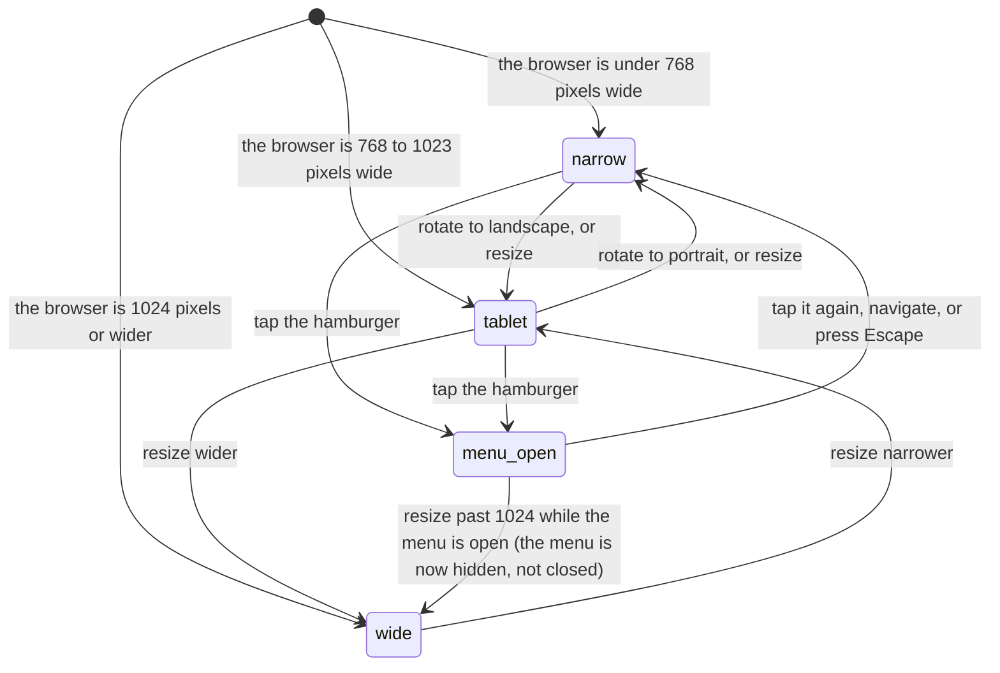

# On a phone

## Summary

This document owns what changes when 717rec is opened on a small screen in a
mobile browser. Every other document assumes a desktop browser and carries one
"On a phone" paragraph; this is where the shared behaviour behind those
paragraphs is written down once.

Most of the app does not change. Layouts re-flow, a few tables become card lists,
and two pieces of navigation swap places. **One surface is designed the other way
round** — live scoring is built for a phone first and merely tolerated on a
desktop — and it has its own six documents starting at
[`../live-scoring/start-a-live-match.md`](../live-scoring/start-a-live-match.md).

The **native app shell is out of scope**, as the README says. This is mobile web,
including the app installed to a home screen.

**Sections dropped.** This document drops the five named phases (**arrive**,
**leave without changing anything**, **begin editing**, **while editing**,
**submit**) and the **Modifiers** table. The viewport is not an interaction; it
is the modifier axis of every other document, so a modifier table here would have
one row and say nothing. The interrupt list is kept in full, because a phone
interrupts differently from a desktop and that is the most useful part of this
document.

## The simple case

A player opens the app on a phone. The top bar keeps the league's name and the
user menu, the notification bell, and the theme button, and folds every link
behind a hamburger. A tab bar appears fixed at the bottom of the screen with four
tabs: Standings, Schedule, Teams, Playoffs. The page above it is padded so the
tab bar never covers its last line.

They tap Teams. The teams list arrives grouped by division rather than in one
long list, because that is the default on a small screen and not on a large one.
They open a team, read it, and press back. `/teams` puts them back where they were:
in a 2026-11-06 test in headless Chromium at 390 pixels wide it did, within 1 pixel,
in every run (see
[navigation](../foundations/navigation.md#open-questions-and-verification)). Safari
and iOS were not tested.

They tap a control that fails. A red panel appears across the **top** of the
screen, not the bottom.

## What changes at 768 pixels

The app has one JavaScript breakpoint: **768 pixels wide**. Below it, the app
calls itself mobile. Above it, desktop. The stylesheet has more breakpoints —
480, 640, 768, 1024, 1280, 1536 — and two of them change what is on the screen:
768 for everything in the table below, and **1024 for the top bar's links alone**.

| Below 768 | From 768 up |
| --- | --- |
| A fixed tab bar at the bottom of the screen, four tabs: Standings, Schedule, Teams, Playoffs | No bottom bar, and nothing replaces it — the top bar is the only navigation |
| No search | A search icon in the top bar, and **Cmd/Ctrl+K** opens a command palette that jumps to nine pages or any of the first ten teams |
| Pages get five extra lines of bottom padding, plus the phone's own safe area, so the tab bar clears the content | Ordinary page padding |
| Toasts fill the width at the top of the screen, below the notch | Toasts are at most 420 pixels wide, bottom right |
| The teams list defaults to grouped by division | The teams list defaults to one list |
| Several stats and standings tables render as stacked cards | The same data as a table |
| Five dialogs open as a bottom drawer: score submission on the home page, the match form on the schedule, approving a score submission in admin Scores, playoff team divisions and the live scoring player picker. Every other dialog is a centred box with a 16-pixel gap each side | The same five open as centred dialogs |

The top bar is the one exception, and it changes later:

| Below 1024 | From 1024 up |
| --- | --- |
| Every navigation link is behind a hamburger button in the top bar | The links sit across the top bar |

Below 1024 the top bar carries the hamburger **and**, beside it, the login or
user menu (which holds the Admin Panel), the notification bell and the theme
button. Only the navigation links fold behind the hamburger.

That gap matters on a tablet. Between 768 and 1023 pixels the bottom tab bar is
already gone, so the top bar is the only complete way around. Before this was
fixed the top bar tried to lay out all nine links at that width and pushed the
login menu, the bell and the theme button off the edge of the screen, with the
hamburger hidden and no way to recover them.

Everything else is the same content at a different width. Wide tables sit in
their own box and scroll sideways inside it rather than stretching the page; the
page itself never scrolls sideways.

The command palette is worth naming plainly: **the app's only keyboard shortcut
exists only on a screen 768 pixels or wider**, because the component that listens
for it is not rendered below that. It lives in the top bar, beside the hamburger
on a tablet and after the links on a desktop.

## Crossing the line while using the app

The breakpoint is watched live, not read once. Rotating a large phone into
landscape can push it past 768 pixels, and when that happens the bottom tab bar
disappears and the top bar's Search button appears **while the user is looking at
the page**. Nothing replaces the tab bar; every link is behind the hamburger
until 1024 pixels. Nothing is lost — no page state is tied to the breakpoint —
but the controls move out from under the thumb. The hamburger does **not** go with them: it stays
until 1024 pixels, so a phone in landscape keeps a way to reach every link.

Rotating back does the reverse. The hamburger menu, if open, closes on the next
route change but not on rotation, so it can be left open in a layout that no
longer shows it.

## The one screen built for a phone

Live scoring is the exception to everything above. It is a single narrow column
of large controls with generous padding at the bottom for a thumb, and on a wide
screen it stays a narrow column in the middle rather than spreading out. Every
control on it is at least 44 pixels tall. It is also the only screen that keeps
an open connection to the league, so two phones scoring the same match stay in
step. Its six documents start at
[`../live-scoring/start-a-live-match.md`](../live-scoring/start-a-live-match.md).

## Touch and reach

- The hamburger button is 44 by 44 pixels. Every control on the live scoring
  screen is at least 44 pixels tall. So are nearly all the controls in the admin
  console, measured at 390 and 320 pixels wide: the Sections drawer's search box
  and group headings, the clear-search cross, every select box (they were 40
  pixels, and five of them set their own 24 to 40), every tab, the theme button in the top
  bar, the calendar's month arrows, the close cross of a dialog, the small round
  and remove buttons (the remove-signup, hero card remove and reaction picker
  buttons are pinned by tests, not measured in a browser), the text fields that once set their own height, and the
  block buttons in Timeslots and the Scores time-slot headers. A switch or a
  checkbox looks the same as before and has an invisible 44-pixel tap area (the
  Auto Schedule team checkbox is the one exception, in the next bullet). In a
  list of options or a menu, each row is 44 pixels tall on a touch screen; a
  mouse keeps the 36-pixel row. The four Scores result buttons (2–0, 2–1, 1–2,
  0–2) sit in one row from 342 pixels wide and in two rows of two below that, so
  each is at least 44 pixels wide on a 320-pixel phone (it was 38.5).
  The Full Season Recap strip on each history card is 44 pixels high on a phone
  too (41 from 768 pixels wide; it was 33 on a phone). So is the tap area of a
  team name on a history phone card or table row, which is a link. On the
  Champions panel it is about 27 pixels high, because the rows there are only 6
  pixels apart.
- A few controls are still under 44 pixels, on purpose: the day cells of a
  calendar are 36 pixels wide and 44 tall (seven must fit a 320-pixel phone), the
  two Auto Schedule switches that sit one above the other share the 36-pixel gap
  between them, the Auto Schedule team checkbox has a tap area 30 pixels wide (its
  scrolling list cuts the left side, and the team name beside it toggles the same
  box), and the small clear cross inside a multi-select was left alone.
  The select box, tab, switch, checkbox, close cross and small buttons are shared
  pieces, so they have the same size on the public pages. The home page's "Score
  live" button, the schedule card's live-score, "Watch live" and recap buttons and
  the recap dialog's "Open full recap" link are 44 pixels tall too (they were 40).
  The menu (…) beside a player's own match comment is 44 by 44 pixels and always
  shown; it used to appear only on hover, so a phone never showed it. On a
  phone the Teams page's division header bars are 44 pixels tall (they were 40)
  and the standings sort buttons (Power, Win %, SOS, Wins) are 44 (they were 36); so are the career rankings sort buttons, which are a copy of the same code.
  The public pages were scanned control by control at 390 and 320 pixels, with
  fake data, after the admin console. Left as they are: the standings badge
  buttons (32 pixels, side by side), the "View … team details" rows in the
  standings (36), and the "Sign in" and "Sign up" links inside the sentence under
  the login form (39).
- Other controls are whatever size the component library gives, which is
  smaller — but no row is now under **24 pixels**, the accessibility floor. The rows raised to it are the home page's
  weekly-recap team links, the teams page's Sort/View/Style row, a team page's
  last-match and head-to-head rows, and the footer's two links, all of which
  were 16 to 20 pixels. The team name link on a team card, the breadcrumb links,
  "Forgot password?" and "Back to login" were 20 pixels and are now 32 to 36 tall;
  they use padding and an equal negative margin, so nothing around them moves. The
  scan read about 26 pixels of tap height on the team name link, because the text
  below it takes the rest; that is above the 24-pixel floor.
- **Nothing in these places runs past the screen edge on a 320-pixel phone.** A
  select box's list is never wider than the screen, so a long option name wraps
  instead of being cut off. The bell's panel is never taller than the screen and
  scrolls inside, a long notification title wraps and a long list scrolls to its
  end. A Member Approvals request card is the screen width minus the page
  margins, and a long name with no spaces breaks. A long email, name or team
  in the contact inbox wraps inside its card. The team logo in Update Logos shows
  whole (the box showed only the middle 80 of 144 pixels). The My Team edit row
  drops its text under the logo when it would have less than 128 pixels, and the
  long team ID breaks. On live scoring a long team name ends in "…" inside the
  scoreboard and the round history, and each round's "+N" stays on screen; before
  2026-11-09 the names under the game totals ran past both screen edges and long
  rows ran past the list. These are measured in a real browser against fake data,
  not on a real phone.
- **No label is under 12 pixels** on the home page, the standings, the teams
  list or history. Labels there were 9 to 11 pixels, which is unreadable in a
  bar. The schedule and live scoring followed on 2026-11-09: the date strip's
  weekdays, a match card's prediction numbers, High/Medium/Low, "Won", the
  rivalry tag, the timeslot double-header pill and division badge, and live
  scoring's "Games" and thrower headings are 12 pixels (they were 11). Each sits
  in a 16-pixel line, as before, so nothing around them moved; a date chip is
  still 64 pixels tall and "100%" fits its box.
  The playoff bracket's participant names are 15 pixels on a phone (the phone
  rule in `src/styles/brackets-viewer-717rec-theme.css`).
- **A centred dialog keeps a 16-pixel gap on each side** on a phone, has round
  corners, is never taller than the screen minus 32 pixels, and scrolls inside
  when its content is taller. Before, a dialog touched both screen edges. The
  Live Corrections "Edit round" dialog was 668 pixels tall on a 640-pixel-tall
  phone, so its edge and padding ran 14 pixels off the top and the bottom; every
  field and both buttons were still on screen. Now it fits inside the screen with
  a 16-pixel gap, which costs a step on a short phone: on a phone 600 to 640
  pixels tall, Save changes starts below the fold and needs a short scroll inside
  the dialog (the content is 60 pixels taller than the box at 320 by 640 and 80
  pixels taller at 390 by 600). On a phone 844 pixels tall it fits with no
  scroll. A later change is planned for this dialog. A dialog that sets its
  own height limit (for example 80 or 90 per cent of the screen) keeps it. The
  command palette stays clipped and its list scrolls. Measured 2026-11-09 in
  headless Chromium with fake data, at 320, 390 and 1280 pixels, on 15 dialogs
  (team badge, GPA leaderboard, opponent history, match recap, leave team,
  create division, approve request, edit team, Live Corrections edit round,
  change winner and delete round, playoff score editor, edit bracket, update
  seeding, command palette): every box at 1280 pixels kept its size. One dialog
  still scrolls sideways inside itself on a phone, as it did before: Update
  Bracket Seeding. It is tracked separately.
- **Text fields are 16 pixels on a phone**, so iPhone Safari does not zoom the
  page in when one gets focus (it zooms on anything smaller). That covers the
  team search box in pickers and multi-selects, the match comment box, the
  message edit box, the admin hero card fields (week, winner names, extra data),
  the weekly blurb fields and the seed number box when an admin seeds a new
  playoff bracket by hand. From 768 pixels up they stay 14 pixels. Measured in
  the same run: the multi-select search, the comment box, the message edit box
  and the three hero card fields. The home page's team picker search, the weekly
  blurb box and the bracket seed box were not reached with the fake data; they
  were changed by class and not measured in a browser (the team picker uses the
  same search box as the multi-select).
- The phone's safe areas are honoured in the top bar, the bottom tab bar, the
  padding under every page and the toast list, which starts below the notch. A
  notch or a home indicator does not sit over them.
  The playoffs page has no bottom bar of its own.
- The bottom tab bar reaches four of the app's twenty-four routes. The hamburger reaches
  the other main pages — the message board, history, help, contact, and Admin for
  an admin — and the user menu reaches my team, the message board and the profile.
  A team, a weekly recap, a live match, Join and the password pages are in
  neither: a link or button inside another page opens them. Insights and compare
  are in neither menu, and the command palette does not exist below 768 pixels. On
  a phone they open from buttons inside pages: Insights from the standings
  header, Compare from the "Compare Team" button on each standings card, and both
  from Help's Quick Navigation.
- The message board puts its list in a fixed-height scrolling box sized from the
  viewport, so the page has a scroller inside a scroller. On a phone the outer
  page barely moves and the inner list does the scrolling.

## Cancel and interrupt

| Event | Before the first edit | While editing or submitting |
| --- | --- | --- |
| Escape, or a Cancel button | A phone keyboard has no Escape, so on a phone nothing can be cancelled by key; only by tapping a Cancel or Close control. **The hamburger menu has no close-by-tapping-away** — it closes on a route change or by pressing the button again. It does close on Escape, which reaches it from an attached keyboard but not from a touch keyboard. | Same. A dialog's Cancel button works; there is no key that reaches it. |
| In-app navigation away, or switching tab within the page | A link to another page loads it and opens it at the top; switching a tab within the page keeps the scroll position (pressing Tab afterwards moves focus into the tab panel, and the browser scrolls it into view if it is hidden). Back puts `/teams`, `/stats`, `/history` and `/insights` back where they were (except when a page's data arrives late: the restore stops watching after one quiet second, three at most; see [navigation](../foundations/navigation.md#open-questions-and-verification)), and every other page wherever the browser puts it. Measured 2026-11-06 for `/teams` at 390 pixels wide in headless Chromium with fake data: within 1 pixel in every run. The fix is on this branch and not yet live. Safari, iOS, and a real phone's back swipe were not tried. | On the six admin screens that guard unsaved work (listed under Unsaved changes below) the app asks first. Everywhere else everything typed is lost with no warning, exactly as on a desktop. |
| Browser back or forward | The gesture-based back swipe is the browser's, and the app cannot intercept it. It behaves as an in-app navigation. | The six guarded admin screens ask first, because a back swipe is a Back. Everywhere else the same as above. On a phone this is the most likely way work is lost, because the swipe is easy to trigger by accident. |
| Reload, or the tab closed | Everything in memory is lost and every page refetches. A mobile browser closing a background tab to save memory looks identical to a reload when the user comes back. | A sent write still lands. An unsent one is gone. |
| Network lost mid-request | Nothing to lose. Cached data stays on screen and looks current, which on a phone at a venue is the common case. | The request fails and is lost, except on live scoring. **Live scoring holds a round saved with no signal** and sends it by itself when the signal returns; the screen says so ("Offline — 1 round waiting to sync. Keep this page open."). Held rounds live in memory, so a reload or a closed tab loses them, and the browser asks before either. Nothing else is queued. |
| The request fails or times out | A read retries once, then falls back to the page's own state. | One red toast across the top of the screen, covering the top bar while it is there. |
| The session expires | Public pages keep working. | Writes fail. Where the screen shows the reason, it now says "Your session has expired. Please sign in again." (`src/utils/errorHandler.ts`). A phone left in a pocket for hours is the most likely place for a session to lapse. |
| The same record changed in another tab, or by another user | The screens that hold a realtime channel find out; standings, records, and the schedule do not. Two phones at the same live match stay in step, which is the design. | Same. Two phones editing anything without a channel overwrite each other silently. |
| Browser autofill or a password manager writes into the form | Mobile keyboards and password managers fill fields the same way as on a desktop, including the contact form's hidden bot trap. | Same. |
| The window loses focus | Switching apps suspends the tab. Coming back refetches anything past its fresh window, so numbers change as the app is re-opened — far more visible on a phone than on a desktop, because backgrounding is constant. | The request continues while the app is in the background if the browser allows it, and its toast is waiting when the user returns. |

After any interrupt the user is wherever the browser put them, on the page the
browser chose, scrolled wherever they were before.

## Interactions with other systems

**Permissions and roles.** Identical on every screen size. The route into `/admin`
is the user menu, which on a phone sits beside the hamburger. See
[`permissions.md`](permissions.md).

**Season scoping.** No difference.

**Validation and error display.** Field errors appear under fields as they do on
a desktop. Long forms stack rather than sitting side by side.

**Unsaved changes.** Six admin screens ask before their unsaved work is lost:
Auto Schedule, mass score entry, the hero card form, the Live Corrections
edit-round dialog, the blind draw sign-up message and the weekly content pack.
They ask on a link, tab or menu tap, on Back or Forward (a back swipe included),
and on a reload or a closed tab (the browser's own warning). Live scoring asks
before a reload or a closed tab while rounds are held or still sending.
Everything else is unprotected, and a phone exposes it more: an incoming call or
the browser reclaiming a background tab still discards typed work with no
warning.

**Optimistic updates and rollback.** No difference.

**Realtime.** Channels drop and rebuild far more often on a phone, because
backgrounding an app closes them. Each reconnection refetches, so a short drop is
invisible; only live scoring shows the connection's state while it is down.

**Offline.** Live scoring holds rounds until the signal is back (see the
interrupt table). Everything else behaves the same as on a desktop, and going
offline is much more likely. See [`errors-and-offline.md`](errors-and-offline.md).

**Toasts and notifications.** On a narrow screen a toast is full width at the top
of the screen, below the notch. It covers the top bar and the page heading while
it is there, not the submit button at the bottom.

**URL state.** A phone adds nothing to the URL. Sharing a page from a phone shares
what the page keeps in the address (see
[`foundations/navigation.md`](../foundations/navigation.md#while-editing)), for
example the schedule's night, search and chips, the standings view, a comparison, the playoffs
season and bracket. A sort order, an open tab or an expanded panel is not shared.

**On a phone.** This document is the definition.

**Accessibility.** Touch target sizes are set deliberately on live scoring, the
hamburger, the history recap strip, the history team-name links and nearly all of
the admin console, at 44 pixels,
and to a 24-pixel floor on the rows listed under
[Touch and reach](#touch-and-reach). See
[`accessibility.md`](accessibility.md).

**Side effects the user can notice.** Every pageview is recorded with a coarse
device class — iOS, Android, other mobile, or desktop — so the league can see how
much of its traffic is phones. Nothing more precise is stored. See
[`what-the-league-sees.md`](what-the-league-sees.md).

## Edge cases

- **The message board's "Sign in to post messages" bar sits just above the
  bottom tab bar** on a phone (`src/components/message-board/LoginPrompt.tsx`
  places it at the tab bar's height). Measured 2026-11-09 at 390 pixels with
  fake data: the bar's bottom edge meets the tab bar's top edge.
- **A link opens the new page at the top**, which matters most on a phone: a long
  schedule followed by a short page no longer leaves a blank screen ([B-14](../bug-triage.md#b-14-scroll-position-carries-across-every-in-app-navigation),
  fixed). On the way the position passes through two in-between values; see [navigation](../foundations/navigation.md#arrive).
  Back restores the old position on the four routes that save it, and passed every case measured on
  this branch except the late-data stress run (not yet live; not every case failed before it); see [navigation](../foundations/navigation.md#open-questions-and-verification).
- **A large phone in landscape is a desktop** as far as the app is concerned, so
  the bottom tab bar vanishes at an angle rather than at a device.
- **The command palette's keyboard shortcut is unreachable on a phone**, which is
  harmless, but so is the Search button — there is no search anywhere below 768
  pixels.
- **Five dialogs become bottom drawers** on a phone (listed in the table
  above). Every other dialog is a centred box with a 16-pixel gap each side,
  including the live scoring confirmations.
- **The teams page remembers its scroll position, and in the 2026-11-06 test it
  came back to it every time** (headless Chromium, 390 pixels wide, fake data; the
  fix is on this branch and not yet live). Safari, iOS and a real phone were not
  tested.
- **A backgrounded tab that the browser discards** returns as a cold load: the
  cache is gone, every page refetches, and any unsaved work is gone with it.
- **Winter theme adds two hundred animated snowflakes** to the home page, which
  is a battery and motion cost paid on a phone as well as a desktop — unless the
  phone asks for reduced motion, which now switches them off. See
  [`accessibility.md`](accessibility.md).

## Open questions and verification

- **Toasts appear at the top on a narrow screen, not the bottom.**
  [`foundations/messages-to-the-user.md`](../foundations/messages-to-the-user.md)
  says a toast could cover a submit button at the bottom of a small screen. It
  cannot: below 640 pixels the toast is pinned to the top and covers the header
  instead. The foundation is the document that needs the correction.
- Not confirmed by hand: whether the layout swap at 768 pixels is smooth when a
  phone is rotated, or whether it flashes.
- Not confirmed by hand: which stats and standings tables become cards and which
  stay tables. Several components branch on the breakpoint; the list was not
  enumerated.
- Not confirmed by hand: whether any page scrolls sideways on a narrow screen.
  The app shell and every table wrapper prevent it, but no page was measured.
- Not confirmed by hand: how the app behaves when installed to a home screen and
  opened with no connection.
- Not confirmed by hand: whether touch targets on the public pages meet the
  44-pixel guideline everywhere. The admin console and the public pages were
  scanned control by control (390 and 320 pixels wide, fake data). The scan did
  not reach the message board feed (the fake data has no messages), the career
  rankings panel (its sort buttons were fixed from the code and pinned by a test),
  dialogs that need real data, or three
  states whose steps timed out (the team page badge pop-up, the "What is Power
  Score?" pop-up and the "View All Teams" switch on the standings). Live scoring, the
  hamburger, the bracket admin menu and its seeding drag handle, the history
  recap strip, the history team-name links and the shared pieces named under
  Touch and reach (select box, tab, switch, checkbox, close cross, small buttons)
  set it explicitly; the rows listed above
  meet the lower 24-pixel floor, not 44. Not tested on a real phone.
- Assumption: nothing in the product reads device orientation directly. Only the
  width is watched.

Verified against `717rec` commit `ea5c8f4`, except the reduced-motion,
hamburger-menu, and bracket admin behaviour above, all changed after that
commit — see
[B-22](../bug-triage.md#b-22-reduced-motion-is-honoured-in-one-stylesheet-and-ignored-everywhere-else),
[B-23](../bug-triage.md#b-23-the-mobile-menu-is-not-a-dialog)
and [B-24](../bug-triage.md#b-24-bracket-administration-is-unreachable-on-a-phone).
The scroll behaviour changed after that commit: a link now opens the new page at the top ([B-14](../bug-triage.md#b-14-scroll-position-carries-across-every-in-app-navigation)). It was measured in a real browser against fake data on 2026-11-05; see [navigation](../foundations/navigation.md#open-questions-and-verification).
The restore of the scroll position on Back changed again on this branch (not yet live) and was measured on 2026-11-06; the opening story, the interrupt table and the edge cases describe it.
The 44-pixel controls in the admin console, listed under Touch and reach, changed after that commit too (the admin phone polish). So did the 44-pixel history recap strip (the History phone polish). The 44-pixel tap area of the history team-name links was added after it too.
The tap-size fixes (commits `96b6036` to `8626e6c`) changed the first two bullets under Touch and reach, and the phone-overflow fixes (commits `2af1fa1` to `e3a8bdd`) added the bullet that starts "Nothing in these places", after that commit. They were measured in a real browser against fake data, not on a real phone or tablet. The three 44-pixel buttons named there came later, in commit `fd5d43a`; they are pinned by tests and were not measured in a browser. The division header bars, the standings sort buttons and the 32 to 36-pixel links came in commit `6e15b27`; they were measured in a real browser against fake data at 320, 390, 768 and 1280 pixels. The career sort buttons came in commit `0524ba6` and are pinned by a test only.
The centred dialog gap, height limit and inside scroll, the 16-pixel text fields
and the toast list below the notch came in the Wave 1 phone polish (2026-11-09).
They were measured in headless Chromium against fake data at 320, 390 and 1280
pixels, not on a real phone; iPhone Safari's zoom on focus was not tried on a
device. The five bottom drawers, the 15-pixel bracket names, the held live
scoring rounds, the session-expired message, the unsaved-work warnings and the
sign-in bar's position were read from the code on that date; the sign-in bar was
also measured.
The 12-pixel schedule and live scoring labels, the always-shown comment menu, the
"Watch live" button and the live scoring long-name layout came in the Wave 2
phone polish (2026-11-09). They were measured in headless Chromium with fake
data at 320, 390 and 1280 pixels, including live scoring mid-game, not on a real
phone. The double-header pill, the division badge and the rivalry tag were not in
the fake data; they changed by class only.
