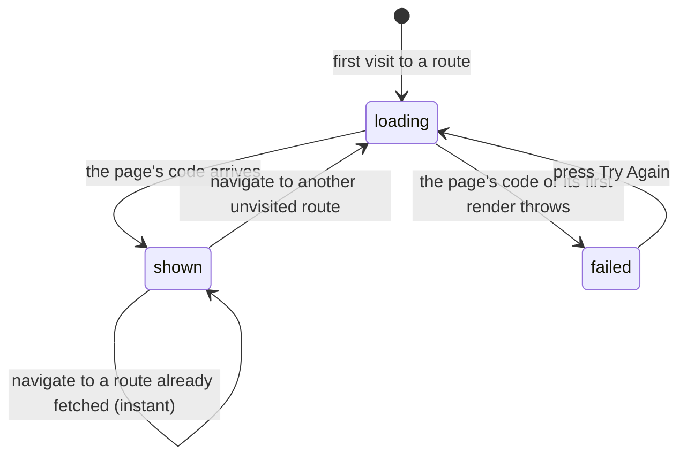

# Navigation

## Summary

717rec is one page in the browser that swaps its contents as the user moves
around. Every route is loaded on demand the first time it is visited, so moving
to a page the user has not seen yet shows a brief loading message before the page
appears.

This document owns the list of routes, what is in the URL, what a page shows
while it loads, what happens when one fails, and what the app does — and does not
do — about scroll position and focus. Other documents link here.

## The simple case

The user opens the app at `/`. A navigation bar sits at the top of every page; a
footer sits at the bottom. They click "Schedule" and the URL becomes `/schedule`.
For a moment a spinner reading "Loading page..." fills the middle of the screen,
then the schedule appears. Going back to the home page and forward to the
schedule again is instant, because the page has already been fetched.

The browser's back and forward buttons work normally. Nothing the app does can
stop them, and nothing warns before leaving a page with unsaved work.

## The routes

| Route | What it is | Signed out |
| --- | --- | --- |
| `/` | The home dashboard | Readable |
| `/teams` | The teams list | Readable |
| `/teams/:teamId` | One team | Readable |
| `/recap/:seasonSlug/:week` | One weekly recap, for example `/recap/<season>/week-<n>` | Readable |
| `/schedule` | The season schedule | Readable |
| `/stats` | Standings and rankings | Readable |
| `/playoffs` | The bracket | Readable |
| `/history` | Past seasons | Readable |
| `/compare` | Compare two teams | Readable |
| `/insights` | League insights | Readable |
| `/message-board` | The message board | Not guarded; behaviour when signed out is unconfirmed |
| `/my-team` | Manage your team | Not guarded; behaviour when signed out is unconfirmed |
| `/matches/:matchId/live` | A match being scored live | **Readable.** Watching is public; scoring is not |
| `/help` | Help | Readable |
| `/contact` | The contact form | Readable and writable |
| `/join` | Join the League: the league's details and a sign-up button | Readable |
| `/auth` | Sign in and register | Readable |
| `/forgot-password` | Ask for a password-reset email | Readable |
| `/reset-password` | Choose a new password, from the link in that email | Readable |
| `/setup-profile` | Finish your profile | Not guarded |
| `/oauth/consent` | Authorise another app | Not guarded |
| `/admin` | The admin dashboard; redirects to the section last open | **Guarded**: redirects to `/auth` |
| `/admin/:section` | One admin section, e.g. `/admin/scores` | **Guarded**: redirects to `/auth` when signed out |
| `/timeslots` | Nothing of its own; redirects to `/admin/timeslots` | **Guarded**: redirects to `/auth` when signed out |
| anything else | Page not found | Readable |

Only three routes are guarded. See
[`accounts-and-roles.md`](accounts-and-roles.md#how-pages-are-gated) for what
the guard does and why the others are not.

## The interaction, event by event

The unit here is arriving at a route.

### Arrive

The URL changes and React Router matches a route. If the page's code has not been
fetched yet, a spinner reading "Loading page..." fills at least 60% of the
viewport height until it arrives.

Three things happen on every arrival, on every route:

- The route is recorded as a pageview, both to Google Analytics and to the
  league's own counter.
- Timing for how long the previous page took is recorded.
- A screen-reader announcement is made naming the new page, and focus is moved to
  the main content area — but **not on the very first page load**, only on
  navigations after it.

**A link opens the new page at the top.** Moving from the bottom of a long
schedule to a short page shows the top of the short page. The reset happens when
the path changes, and only then. A link that names a place on the page (`#match-<id>`
on the schedule, `#career` on a team) then scrolls to that place. The new page used to inherit the old scroll
position, which was a defect; see [B-14](../bug-triage.md#b-14-scroll-position-carries-across-every-in-app-navigation). Measured in a real
browser against fake data on 2026-11-05, on the dev server and on the production
build: scrolled 337px down `/schedule`, followed the Help link, arrived at 0.
**The move to the top passes through two in-between positions.** Measured on
2026-11-06 (fake data, headless Chromium), frame by frame the scroll position read
900, 111, 25 and 0 over 91 frames. It is not shown to be a glide: the run with
reduced motion on read the same list, and with reduced motion the site turns smooth
scrolling off. The cause was not isolated. See [Open questions](#open-questions-and-verification).

Browser Back and Forward are not reset, which leaves the browser free to put the
user back where they were. Four routes also have code of their own that does it:
**`/teams`, `/stats`, `/history`, and `/insights`**. While one of them is open it
saves how far the reader has scrolled, one value per route, in the tab's session
storage. On Back or Forward it then:

- **Jumps to the saved spot at once**, with no glide, and checks where the page
  really landed. If the page is still too short to reach the spot, because its data
  has not arrived, it goes as far as it can and tries again, with growing gaps, up
  to 20 times (roughly fifteen seconds in all).
- **Keeps watching for up to three seconds** once it is there, because content that
  arrives late can move the page. It checks every 50 milliseconds, jumps back if the
  page has moved, and ends after one second in which it needed no correction.
- **Gives way to the reader.** A wheel turn, a touch, a key press (a held key
  repeating does not count) or a mouse press, including a press on a desktop
  scrollbar, ends the restore at once, so it does not pull back a reader who scrolls with one
  of these inputs.
- **Does not save the position while it runs**, which is about 1.1 seconds when the
  data is cached, and saves again as soon as it ends.

A scroll event that arrives while a link click is leaving the page, after the
address has changed, is not saved. On `/history`, after a team link, such an event
used to overwrite the saved spot with a smaller number: the saved offset was right in
only 6 of 10 runs before the fix (measured 2026-11-06, fake data). It was not the
cause of every failed Back: after the phone's bottom tab bar the saved offset was
already right in 9 of 9 runs before the fix (see the measurements under Open
questions).

> **Technical note:** one cause of a late move is Chrome's scroll anchoring. When
> content above the view changes size, the browser shifts the page, and the restore
> jumps it back to the saved offset. This cause is INFERRED from round-one runs in
> which switching scroll anchoring off made the same code exact (reduced-motion reload
> 5 of 5 against 0 of 5, `/teams` at 304px 3 of 3 against 0 of 5).

Measured on 2026-11-06 in headless Chromium against fake data: Back to `/history`
at 390px landed within 1px of the saved offset in 10 of 10 runs with the page's data
cached and in 10 of 10 after the team page was reloaded. Before the fix the same
scripts gave 6 of 10 and 2 of 10. The full numbers, the limits, and what was not
tested are in [Open questions](#open-questions-and-verification). `/history` also
keeps its open seasons and divisions on Back (see
[`history/past-seasons.md`](../history/past-seasons.md#leave-without-changing-anything)).

Every other route — the home page, the schedule, a team's page, the playoffs, the
message board, live scoring — does not save or restore its own scroll position; the
schedule came back at the top in the 2026-11-05 test.

Nothing is prefilled or focused by arriving, beyond the main-content focus move
above. Three lightweight pages — teams, schedule, and history — are fetched
quietly in the background after the first render, so those three are usually
instant even on a first visit. The heavy pages, stats and playoffs, are
deliberately not, so they show the loading spinner.

### Leave without changing anything

Nothing is recorded beyond the pageview that already happened on arrival. No
page in the app keeps a draft of anything on leaving.

### Begin editing

Not applicable to navigation itself. Individual pages own this.

### While editing

Most page state is held in the page and lost on navigation: sort orders, most
tabs, which panels are expanded, and the scroll position are not in the URL and
cannot be linked to or bookmarked. (Four routes do keep the scroll position for
Back, in the tab's session storage; see *Arrive*.) Several pages do write some state to the
address, so that a view can be linked to, bookmarked or reloaded:

- `/teams/:teamId` and `/matches/:matchId/live` carry a record id. The team page
  also carries the section last chosen on its section bar, as a hash (for example
  `#stats`, `#career`).
- `/admin/:section` carries the open admin section.
- `/schedule` carries the night, the search text and the division and My team
  chips. A link that ends in `#match-<id>` scrolls to that match.
- `/stats` carries the Division / All choice, as `?view=all`.
- `/compare` carries the two teams, as `?team1=` and `?team2=`.
- `/playoffs` carries the season and the open bracket.
- `/auth` and `/setup-profile` can carry where to go next, as `?next=`. Google
  sign-in and the consent page's sign-in redirect use it. Other sign-in redirects
  (the Sign in button, the admin guard, the message board's sign-in prompt) keep the
  destination in the browser's history entry instead. It is not in the address, so a
  copied link or a bookmark loses it. The consent page carries its request number,
  as `?authorization_id=`.

Two pages also read a value from the address on arrival. The contact form reads
`?type=` (its topic) and `?solo=true` (its solo box) on arrival, and `?source=join_page`
(where the visitor came from) when the message is sent. The admin timeslots section takes a night, a team and a slot,
or what the team asked for, that another admin section hands it, and removes them
from the address once it has used them. Each page's own document
says exactly what it writes.

### Submit

Not applicable to navigation itself.

## Modifiers

| Modifier | Set at arrival | Changed while on the page |
| --- | --- | --- |
| The user's role | Decides only whether the three guarded routes render, redirect, or refuse. Every other route renders the same for every role. | Signing out in another tab takes effect here immediately and can remove controls under the cursor. It does not force a redirect off an unguarded page. |
| The record's state | A team and a live match are read from the URL (`/teams/:teamId`, `/matches/:matchId/live`). Compare reads two team ids, the playoffs page a bracket id, and the consent page a request number. For a team or a match, a missing or invalid id gives that page's own empty state, not the 404 page. | No effect on routing. |
| The season's state | No effect on which routes exist. | No effect. |
| Viewport | The navigation bar collapses to a menu on a narrow screen. | Re-flows on rotation. |
| Keys the app honours | **Cmd/Ctrl+K opens a command palette** for searching and jumping to one of nine pages, or to a team by name. It is the app's one global shortcut and it exists only on a screen 768 pixels or wider — on a phone there is no way to reach it. It lives in the top bar as a search icon, whose tooltip names the shortcut. Tab reaches a skip link to the main content first. | The palette can be opened at any time and closed with Escape. |

## Cancel and interrupt

| Event | Before the first edit | While editing or submitting |
| --- | --- | --- |
| Escape, or a Cancel button | No global effect. There is no global Escape handler. | No global effect; individual dialogs handle their own. |
| In-app navigation away, or switching tab within the page | A link to another page loads it and opens it at the top (the position passes through two in-between values on the way, see *Arrive*). Switching a tab within the page keeps the scroll position (pressing Tab afterwards moves focus into the tab panel, and the browser scrolls it into view if it is hidden). | **The page's state is discarded with no warning.** No route in the app blocks navigation for unsaved work. Requests already sent still complete, unseen. |
| Browser back or forward | Works normally; the app cannot intercept it. | Same as navigating away. Coming back gives a freshly mounted page, not the one that was left. |
| Reload, or the tab closed | The whole app is re-fetched and re-initialised. Sign-in state survives; everything else does not. | Everything in memory is lost. |
| Network lost mid-request | If the page's own code has not arrived, the loading spinner stays indefinitely — there is no timeout and no error for a chunk that never loads. | Data requests fail and each page reports it in its own way. |
| The request fails or times out | A page whose code fails to load, or whose first render throws, is replaced by the route error screen described below. | Data failures do not reach the error screen; they are the page's own business. |
| The session expires | No effect on unguarded routes. On the three guarded ones, the next visit redirects to `/auth`. | No redirect happens on a page already open. The user finds out when a write fails. |
| The same record changed in another tab, or by another user | No effect on routing. | No effect on routing. |
| Browser autofill or a password manager writes into the form | No effect on routing. | No effect on routing. |
| The window loses focus | No effect. | Returning focus causes cached data older than five minutes to refetch. See [`saving-and-freshness.md`](saving-and-freshness.md). |

After any interrupt the user is wherever the browser put them. The app never
returns a user to an interrupted page. It restores only what a page chose to keep:
what is in the address (see *While editing*), a few choices saved in the browser (for
example the teams page's style and grouping and the schedule's tab), and, on four
pages, the scroll position (see *Arrive*).

## When a page fails

Two different failures produce two different screens.

**A page that fails to load or render** is replaced by a route error screen: a
warning triangle, "Failed to load *page name*", the sentence "Something went
wrong loading this page. You can try again or navigate elsewhere.", and three
buttons — Try Again, Go Back, and Home. In a development build the underlying
error message is shown as well; in the published build it is not. "Home" is a
full page load, not an in-app navigation, so it discards everything.

Either error screen clears on the next in-app navigation. Moving to another page
is a fresh attempt, so the new page renders normally — a single failure does not
follow the reader around for the rest of the visit.

**A URL that matches no route** gives the Page Not Found screen: "Oops! The page
you are looking for does not exist or has been moved.", with Go Home and Go Back
buttons. The attempted address is recorded in the log but not shown to the user.

A **failed data request** produces neither of these. It is handled inside the
page, usually as an empty state and a toast.

## Interactions with other systems

**Permissions and roles.** Only the three guarded routes behave differently by
role. See [`accounts-and-roles.md`](accounts-and-roles.md).

**Season scoping.** The active season is not in the URL of `/schedule`, so a link
to it means "whatever season is active when it is opened". The playoffs page is
the exception: it writes the season into the address. See
[`seasons.md`](seasons.md).

**Validation and error display.** Route parameters are not validated. A malformed
team id reaches the team page, which shows its own not-found state rather than
the 404 route.

**Unsaved changes.** Not handled anywhere in the app. No route blocks navigation.

**Optimistic updates and rollback.** Not applicable to navigation.

**Realtime.** Several routes open a subscription and all of them close it when
the user navigates away. See
[`saving-and-freshness.md`](saving-and-freshness.md#realtime).

**Offline.** Already-fetched pages still navigate. Not-yet-fetched pages hang on
the loading spinner with no error.

**Toasts and notifications.** Toasts survive navigation — a toast raised on one
page is still visible on the next, because there is one toast area for the whole
app.

**URL state.** See *While editing* above for what each page writes to the address.
Sort orders, most tabs, expanded panels and the scroll position are not in the
address and cannot be linked to. Four routes keep the scroll position for Back in
the tab's session storage.

**On a phone.** The navigation bar becomes a menu. Everything else is the same.

**Accessibility.** A skip link reaches the main content. Route changes are
announced and move focus to the main content, except on the first load, and the
new page opens at the top (after two in-between positions, see *Arrive*), so once it settles what is on
screen matches where focus went. The
command palette is the only keyboard route to fast navigation and it
is absent below 768 pixels.

**Side effects the user can notice.** Every route change is recorded twice, once
to Google Analytics and once to the league's own pageview counter. In a
development build the analytics call does nothing.

## Edge cases

- **Back and Forward bring `/teams`, `/stats`, `/history` and `/insights` back
  where they were left (Forward was not tried in a browser); every other page comes back wherever the browser puts it.**
  The four routes jump to the saved spot and hold it for a moment, and give way
  when the reader scrolls (see *Arrive*). A user who presses Back to `/schedule`
  gets what the browser gives: the top, in the 2026-11-05 test. Data that arrives
  after the watch window (one quiet second, three at most) is not caught; see
  [Open questions](#open-questions-and-verification).
- **A chunk that never downloads leaves the spinner forever.** There is no
  timeout, no retry, and no error.
- **"Home" on the error screen is a full page load**, unlike "Home" anywhere else
  in the app.
- **The first page load does not announce or move focus**, deliberately, so a
  screen reader is not interrupted mid-sentence on arrival.
- **`/playoffs/e2e-bracket-proof` exists** as a test route and is out of scope.
- **A sort order or an expanded panel is lost on every navigation.** Sorting the
  standings table, opening a team, and pressing back gives the default order. The
  schedule's search and chips and the standings view are in the address, so Back
  brings those back.
- **The command palette is desktop-only.** Cmd/Ctrl+K does nothing below 768
  pixels, where the app is most used.
- **Six routes are never in a menu, by design.** `/forgot-password` and
  `/reset-password` are reached from the sign-in form and from an email;
  `/oauth/consent` is reached by another app; the not-found route is reached by
  being wrong; `/join` is reached from the Join the League button on the home
  page; `/recap/:seasonSlug/:week` is reached from the home page's Weekly Recap
  block and from shared links. Three more are reached by a link inside a page rather than
  from the top bar or the tab bar: a team, a live match and an admin section.
  Every other route is offered by the top bar,
  the phone tab bar, the user menu or the palette.

## Open questions and verification

- Settled 2026-11-05: **a link opens the new page at the top.** On 2026-08-25 it
  did not (337px before, 337px after), which was [B-14](../bug-triage.md#b-14-scroll-position-carries-across-every-in-app-navigation). Measured again in a real
  browser against fake data, on the dev server and on the production build:
  337px before, 0 after.
- **Settled on this branch, not yet live: the four routes' own scroll restoration
  now works in every case measured except the late-data stress run (see the known limit below)** ([B-14](../bug-triage.md#b-14-scroll-position-carries-across-every-in-app-navigation),
  checklist item `NAV-02`). On 2026-11-05, on the production build against fake data,
  it mostly did not: `/stats`, then a team page, then Back came back at 300 of
  300px, and Back landed at 0 in every other case tried (from `/stats`, `/teams`,
  `/history` and `/insights` after Help or Schedule, and from `/teams` after a team).
  Two faults were found in the shared scroll-restore code, and the 2026-11-06
  measurements below show both on `/history`. A scroll event that fired while a link
  click was leaving the page could save a smaller offset over the real one. And the
  restore compared the page's height with the saved offset instead of checking where
  the browser had really landed, so on a page that was still loading it ended short.
  The code now ignores scroll events once the address has changed, jumps, reads back
  where it landed, and retries, up to 20 times (about fifteen seconds), until it is there. The first fault is measured for
  `/history` after a team link. For `/teams` after the phone's bottom tab bar the saved
  offset was right and the restore landed short (below; the cause was not isolated,
  INFERRED to be the height comparison). That the two faults explain every 2026-11-05
  result, `/stats` and `/insights` included, is not shown: see the before-fix numbers
  below.
  - **Measured on 2026-11-06.** Fake data from a mock, headless Chromium, a fresh
    browser context for every run, the dev server unless stated. "n of n" counts runs that
    landed within 1px of the saved offset; the before and after used the same
    scripts. `/history` at 390px wide, Back from a team page: **10 of 10** with the
    page's data cached and **10 of 10** after the team page was reloaded (so
    `/history` had to load its data again). On a slow phone (CPU slowed four times,
    data delayed): 6 of 6. On the production build: 10 of 10 and 10 of 10. With
    reduced motion on: 5 of 5 and 5 of 5. At 1280px wide: 5 of 5 and 5 of 5.
    `/teams` at 390px: 5 of 5 at an offset of 304px, and 5 of 5 runs across offsets of 100, 200
    and 250px (two, two and one runs). `/stats` 1 of 1 after a team link and `/insights` 1 of 1 after a footer link.
    After the Schedule tab of the phone's bottom tab bar, then Back, at 390px:
    `/stats`, `/teams` and `/insights` 3 of 3 each. In every run the saved offset
    equalled the offset before the click, and four seconds after the restore a
    mouse-wheel scroll was saved again. A spot check of the same build gave `/teams`
    at 304px 3 of 3, `/history` cached 4 of 4 and after the team page was reloaded
    4 of 4, and `/history` with reduced motion after the team page was reloaded 3 of 3.
  - **The same scripts on the code before the fix**, also 2026-11-06: `/history` at
    390px landed within 1px in 6 of 10 runs with the data cached and in 2 of 10 after
    the team page was reloaded (production build: 7 of 10 and 5 of 10); with reduced
    motion on, 1 of 5; and the saved offset was right before the page was left in
    only 6 of 10 runs, which is the overwrite described above. `/teams` at 304px after
    a team link came back in 5 of 5. After the Schedule tab of the phone's bottom tab
    bar, then Back, at 390px, before the fix: `/stats` 3 of 3 and `/insights` 3 of 3
    (the saved offset was right and the page came back to it), and `/teams` 0 of 3: the
    saved offset was right (150, 250 and 304px) and the page landed at 86px each time,
    so the fault there was in the restore, not in the saving (the cause was not
    isolated; INFERRED to be the height comparison). That agrees with the 2026-11-05
    result for `/teams` (Back came back at the top, not at 86px) in kind, and does not
    agree with the 2026-11-05 results for `/stats` and `/insights` (Back at 0 after a
    top-bar link). What differed between the two tests is not known (the 2026-11-06
    test used the bottom tab bar link on the dev server; the real top bar was not
    tried).
  - **The reader takes over.** A wheel turn at 390px: 3 of 3 runs showed no pull-back.
    A press on a desktop scrollbar at 1280px (a classic 15px scrollbar): 3 of 3 times
    the press reached the window as a pointer event and the restore stopped. A wheel
    turn during the one-second watch window: 3 of 3 stopped it.
  - **No glide from the hook on Back.** In the cached run at 390px the frames read 0, then the saved
    offset, and nothing between. With reduced motion on they read 0, 111, then the
    saved offset; the 111 comes before the hook's jump (its only `scrollTo` call was
    made when the position read 111), so its source is not shown.
  - **Known limit: data that arrives later than the watch window is not caught.** In a
    stress run the page was tall at 3.6 seconds and its real content arrived at 6.8
    seconds; 0 of 2 runs ended at the saved spot. Saving is back on by then, so the
    moved position (965px) was saved over the restored one (907px) and the next Back
    would land there. A second effect of the same design: if the saved spot is below
    the end of a page that is now shorter, the restore retries for about fifteen
    seconds and does not save the position meanwhile, unless the reader scrolls (read
    from the code, not tried).
  - **Not tested:** Safari, iOS and any other WebKit browser (none is installed), a
    real phone, real network timing, Forward in a browser (it takes the same code path
    as Back and is covered by unit tests only), and a closed tab. Scrolling that sends
    no input event, such as find-in-page opened from the browser menu (Ctrl or Cmd+F
    is expected to send a key press, which stops the restore; not tried), a screen reader or voice control,
    does not count as the reader taking over. A touch or key press was tried only in
    unit tests; the browser runs saw a wheel turn and a mouse press. Read from the code, not tried: the restore can
    pull the page back against such scrolling while it runs. Not tried either:
    `/insights` after a team page (the fake data had no link to one on that page when
    this was first tried).
- **Open, a finding: the move to the top after a link passes through two in-between
  positions.** Measured on 2026-11-06 (fake data, headless Chromium): frame by frame
  the scroll position read 900, 111, 25 and 0 over 91 frames. The component that sends
  the page to the top asks for a plain jump (`scrollTo(0, 0)`), and the site's smooth
  scrolling could turn that into a glide. The data do not show one: the run with
  reduced motion on, where smooth scrolling is off, read the same list, and a glide
  would show many values, as the old Back restore did (0, 3, 19, 81 ... 111).
  INFERRED, not shown: the browser clamps the position as the shorter new page replaces
  the old one. No change was made and it is not decided whether it matters. The
  component's unit test and an end-to-end spec both assert the plain call, so a change
  would have to update them.
- Not confirmed by hand: what `/my-team`, `/message-board`, and `/setup-profile`
  show to a visitor. They have no route guard.
- Not confirmed by hand: whether the post-sign-in redirect returns the user to
  the guarded page they originally asked for.
- "Try Again" on the route error screen recovers when the page renders on the
  second attempt, and re-throws when it does not. Covered by a test.
- Not confirmed by hand: how long the loading spinner is visible in practice on a
  normal connection, and whether it flashes on fast ones.
- Assumption: the three preloaded routes are teams, schedule, and history because
  they are the cheapest, as the code comment says. Not measured.

Verified against `717rec` commit `ea5c8f4`, except the navigation surfaces, which
changed with W11: the desktop pill bar that used to sit under the page content is
gone, the command palette moved into the top bar, Compare and Insights joined the
palette and Help's Quick Navigation, and an admin sees an "Admin" link in the top
bar and the phone menu rather than only in the user menu. The list of what each page
writes to the address (While editing) was read from the code and checked in a real
browser against fake data on 2026-11-05. The routes table now lists every route
in `src/App.tsx` except the dev-only test route. The scroll behaviour changed
after that commit and was measured the same way on 2026-11-05; see [B-14](../bug-triage.md#b-14-scroll-position-carries-across-every-in-app-navigation).
The restore of the scroll position on Back changed again after that, on this
branch and not yet live. The passages on Back and Forward, the interrupt rows, the
edge case and the open questions describe it, and it was measured in headless
Chromium against fake data on 2026-11-06. Safari, iOS and real phones were not
tested.
