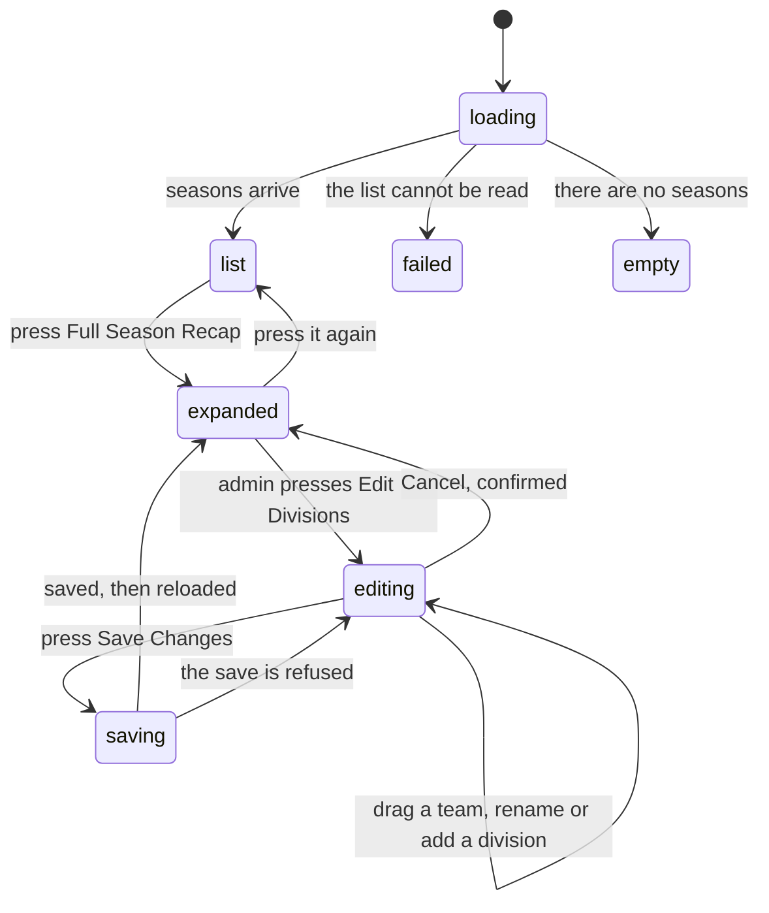

# Past seasons

## Summary

The history page is where the league's finished seasons are kept. It shows one
card per season, newest first, each carrying that season's champions, three
headline numbers, and — when opened — the full final standings split by
division.

It lives at `/history` and is open to everyone. Nothing on it can be changed by a
player. An admin gets one extra control inside an opened season: the ability to
move teams between divisions and reorder them, which is the only write this page
has.

The numbers here are frozen. An archived season's standings, power scores, and
strength of schedule do not move when the league later changes how those numbers
are worked out — except saving new Power Score weights in the Sandbox, which
recomputes every season, archived included. See
[`../foundations/seasons.md`](../foundations/seasons.md#what-frozen-means).

## The simple case

The user opens `/history` and sees a card headed "Loading historical data..." for
a moment, then a stack of season cards with the most recent at the top.

Each card gives the season's name, the months it ran, and a line reading
something like "12 teams · 66 matches". Under that sit two small panels side by
side: **Champions**, listing each division's winning team with its record, and
**Highlights**, giving Most Wins, Best Power Score, and Most Game Wins. On the
Champions panel each team name is a link to that team's page. The Highlights
panel has no links.

At the foot of every card is a strip reading **Full Season Recap**. Pressing it
slides open the final standings, one panel per division, ordered Competitive
first and Recreational last. The panels sit one above another in **one column at
every width**. Each panel is a table: rank, team, match record, win percentage,
game record, game win percentage, power score, and strength of schedule. Each
team name in a table row is a link to that team's page. The champion's row is
tinted gold with a crown; the runner up's is grey with a medal.

Pressing the strip again closes it. Nothing is sent to the league. The page does
remember which cards and panels are open, for this browser tab only, so the
browser's Back button brings them back open; see
[Leave without changing anything](#leave-without-changing-anything).

## The interaction, event by event

### Arrive

The page loads on its own, so there is a brief blank the first time in a session.
Then one request fetches every season's name, dates, and active flag, ordered by
start date with the newest first.

**Every season is listed, not only the archived ones.** The season the league is
playing right now appears at the top with a green **Active** badge. A season with
no champion recorded and no active flag gets no badge at all.

Each season card then fetches its own standings as soon as it appears —
**before** anything is expanded, and for every card on the page at once. Ten
seasons means ten requests on arrival.

> **Technical note:** those per-season requests are marked as never fresh, so
> they run again every time the page is mounted. Most of the app keeps data for
> five minutes; this page does not. See
> [`../foundations/saving-and-freshness.md`](../foundations/saving-and-freshness.md#how-long-data-is-kept).

While a card's standings are loading, its two summary panels are grey
placeholders. When they arrive, the "N teams · M matches" line appears with them.

Nothing is focused on arrival. Nothing is recorded beyond an ordinary pageview.

### Leave without changing anything

Nothing is sent to the league. The page remembers which seasons and divisions are
open, in the browser tab's session storage (key `history_open_state`), for this
tab only.

**Back, Forward and a reload keep them open.** Arriving by a link to `/history`
or by the top-bar menu clears the memory first, so the page opens fully collapsed.
A top-bar link is not Back. An address typed or bookmarked into the same tab is a
full page load, so it counts as a reload and keeps what the tab left open. With nothing remembered, a division still
starts closed on a phone and open on a wide screen. A wide window shrunk to phone
width still closes its divisions and remembers that they are closed; they stay
closed when the window grows back. A season or division left open appears at full
height, with no grow-in animation. A new tab starts closed. If the browser blocks
or breaks storage, everything starts closed, as it did before.

`/history` also remembers its **scroll position** and restores it when the user
comes back with the browser's back button — one of four routes that do (how it
works is in [navigation](../foundations/navigation.md#arrive)). The page jumps
straight to the saved spot, keeps it for up to three seconds while late content
settles, and stops at once if the reader scrolls. Measured 2026-11-06 on the dev
server with fake data in headless Chromium, going Back from a team page at 390
pixels wide: the position came back within 1 pixel in 10 of 10 runs with the page's
data already cached, and in 10 of 10 after the team page was reloaded, so that the
history page had to load its data again. On a slow phone (CPU slowed four times,
data delayed) it was 6 of 6. On the production build it was 10 of 10 and 10 of 10;
with reduced motion on, 5 of 5 and 5 of 5; at 1280 pixels wide, 5 of 5 and 5 of 5.
The same scripts before the fix gave 6 of 10 and 2 of 10 (production build 7 of 10
and 5 of 10), and 1 of 5 with reduced motion. The season and the division stayed
open in 10 of 10 runs in the earlier 2026-11-05 test; the open state is kept
separately from the scroll position. Two limits. Data that arrives after the
watch window (one quiet second, three at most) is not caught. And a link other than a team link, then
Back, was not tried on this page after the fix (the 2026-11-05 test, with such a
link, landed at the top). Safari, iOS and a real phone were not tested.

### Begin editing

There is no form here for a player. The two things that behave like beginning are
opening a recap and, for an admin, entering edit mode.

Opening a recap changes nothing outside the browser. With nothing remembered, on a
wide screen every division panel inside it starts open; on a phone every panel
starts closed and has to be tapped open one at a time. A panel is closed from the
first moment on a phone, so the recap never draws every team card and then folds
them away. A panel this tab left open (see
[Leave without changing anything](#leave-without-changing-anything)) comes back
open on Back, Forward or a reload, on a phone too.

An admin sees an **Edit Divisions** button at the top of an opened recap. Pressing
it replaces the read-only panels with a drag-and-drop board and a toolbar. The
toolbar reads "No changes" in green until the first change, then "N unsaved
changes" in amber. Nothing is written yet.

### While editing

In edit mode the admin can drag a team to another division, drag it up or down
within its division, rename a division in place, add an empty division, and
remove a division that has no teams left in it.

Every drop renumbers the ranks in both the division the team left and the
division it joined, so ranks stay 1, 2, 3 with no gaps. Removing a division that
still holds teams is refused with a red toast reading "Cannot Remove Division —
Move all teams out of this division first."

A **Reset** button appears next to Cancel as soon as there is a change. It
discards every local change at once and asks nothing.

The URL never changes. `/history` is `/history` throughout, so an opened season,
an opened division, and edit mode cannot be linked to or bookmarked. What the tab
left open is kept in session storage, not in the address, so it cannot be shared.
Edit mode is not remembered at all.

### Submit

**Save Changes** sends only the teams whose division or rank differs from what was
loaded. They go in groups of ten, and each team is written twice: once to the
season's standings and once to the archived team record behind them.

On success a toast says "Changes Saved — Successfully updated N teams", the
season's standings are fetched again, and the board returns to the read-only
panels.

On failure a red toast says "Update Failed" followed by **the database's own
reason**. This page is unusual in that respect: most of the app replaces the
server's reason with a generic sentence. The board stays open with every change
still in place.

## Modifiers

| Modifier | Set at arrival | Changed while editing |
| --- | --- | --- |
| The user's role (visitor, player, admin) | Visitors and players see the same read-only page. Only an admin sees the Edit Divisions button inside an opened recap. | Losing admin leaves the board on screen; the save then fails and reports the refusal. Gaining admin does not add the button until the page is re-rendered. |
| The record's state | A season with a champion recorded gets the "🏆 Completed" badge. A season with standings but no champion gets no badge. A season with no standings at all shows no summary panels and no team or match count. If it is not the active season, its opened recap reads "No standings recorded for this season". | An admin editing one season's divisions does not affect any other card. |
| The season's state (active, archived, playoffs on) | The active season shows a green **Active** badge and, if it has no standings yet, its recap reads "Season in progress – check back later". Archived seasons show their frozen numbers. The playoffs flag has no effect here. | A season being archived elsewhere does not reach this page until it is loaded again. |
| Viewport | In an opened recap the division panels sit one above another in one column at every width. (From 1024 pixels wide they used to sit in three columns, which cut off Power and SOS. The change's own measurement found 0 of 4 tables scrolling sideways at 1024, 1280 and 1536 pixels.) With nothing remembered, on a wide screen every division panel starts open, the standings are a table, and a Season Awards strip appears at the foot. On a phone the panels start closed, each team is a card with a power score dial and, for a team with a playoff rank, a small "#N", the awards strip is **not rendered at all**, and a season card's months sit under its title instead of beside it. | A wide window shrunk to phone width closes every division panel and remembers that they are closed. They stay closed when the window grows back. |
| Keys the form honours | Tab reaches every season's Full Season Recap strip, and Enter or Space opens it. Each team name on the Champions panel is a Tab stop too. Inside a recap, Tab reaches the small chevron beside each division name and, in an open division, each team name link, in rank order, between the division chevrons. It does not reach the division name itself. A team link shows a focus ring and is underlined only on hover. The chevron is named "Toggle *division* teams" and reports whether the panel is open. | In edit mode, Enter saves a division rename or a new division name and Escape cancels it. Dragging by keyboard is wired up but not documented anywhere on screen. |

## Cancel and interrupt

| Event | Before the first edit | While editing or submitting |
| --- | --- | --- |
| Escape, or a Cancel button | No effect. There is no Cancel on the read-only page and Escape does nothing. | Escape closes a division rename box. The toolbar's **Cancel** asks "You have unsaved changes. Are you sure you want to cancel?" through the browser's own confirmation box, and discards everything if confirmed. Neither can stop a save already sent. |
| In-app navigation away, or switching tab within the page | Nothing is lost. Which cards and panels were open is remembered for this tab. It comes back on Back, Forward or a reload, and is cleared by a return through a link. | **Every unsaved change is lost with no warning.** The confirmation only guards the Cancel button, not leaving the page. A save already sent still lands, unseen. |
| Browser back or forward | Returns to the previous page. Coming back to this page with Back or Forward keeps the open seasons and divisions open. The page restores its scroll position too: measured 2026-11-06 (dev server, fake data, headless Chromium, 390 pixels wide), Back from a team page brought it back within 1 pixel in 10 of 10 runs with the data cached and 10 of 10 after the team page was reloaded (see [Leave without changing anything](#leave-without-changing-anything) for the limits). A top-bar link to the page is not Back: it opens collapsed. | Same as navigating away, and the app cannot prevent it. Edit mode is not kept. |
| Reload, or the tab closed | The page rebuilds itself: every season fetched again. A reload keeps the open seasons and divisions open, in the same tab. Closing the tab forgets them, and a new tab starts closed. | **Every unsaved change is lost.** A save already sent may have landed; after reloading the standings themselves are the only evidence. |
| Network lost mid-request | The season list fails and the whole page becomes "Failed to load season history". A single card failing shows its own error inside the opened recap, with a **Try Again** button. | The save fails and the red "Update Failed" toast carries the network error. Nothing is queued and nothing is retried. |
| The request fails or times out | The season list is retried once. A single season's standings are retried **twice**, a second apart, before the card gives up. | The save is not retried. Changes stay on screen for the admin to press Save again. |
| The session expires | No effect. Everything on this page reads public data. | The save is refused by the database and the refusal is shown. The board keeps the changes, so pressing Save again after signing back in works. |
| The same record changed in another tab, or by another user | No effect until something causes a refetch. There is no realtime here, so another admin's rewrite of a season is invisible. | **The two admins' last save wins, silently.** Nothing warns that the standings were rewritten under the board, and the board still holds the version it loaded. |
| Browser autofill or a password manager writes into the form | No effect. There are no fields on the read-only page. | The division name and rename boxes are plain text inputs and could be filled, but nothing marks them as a name or address, so in practice nothing offers to. |
| The window loses focus | No effect. Nothing polls and nothing refetches on this page from focus alone. | No effect. A save in flight continues. |

After any interrupt the page is exactly what the database holds. Nothing about an
unsaved drag survives leaving. Which cards and divisions are open does survive
Back, Forward and a reload, in the same tab only.

## Interactions with other systems

**Permissions and roles.** Reading needs nothing at all. Editing divisions is
admin-only, and the button is simply absent for everyone else. The database
enforces the same rule separately, so an admin flag lost between the page loading
and the save landing produces a refusal rather than a hidden button. See
[`../cross-cutting/permissions.md`](../cross-cutting/permissions.md).

**Season scoping.** This is the one page that is *not* scoped to the active
season: it names every season explicitly and shows them all at once. The active
season is included, which is surprising on a page called Season History.

**Validation and error display.** Only two rules exist, both on division names: a
name cannot be empty and cannot repeat an existing name, compared without regard
to capitals. Both show a red line under the input. Nothing validates a drag.

**Unsaved changes.** Guarded in one place only — the toolbar's Cancel button, by
the browser's own confirmation box. Navigating away, reloading, or closing the
tab discards the work with no prompt.

**Optimistic updates and rollback.** Drags are applied to the board immediately,
but that board is a working copy, not the saved record. A failed save leaves the
working copy exactly as it was, which looks like an optimistic update that was
never rolled back.

**Realtime.** None. No subscription is opened anywhere on this page.

**Offline.** The page cannot load and a save cannot be sent. Nothing is queued.

**Toasts and notifications.** Four: "Changes Saved", "No Changes", "Cannot Remove
Division", and "Update Failed". Up to three at a time, as everywhere. See
[`../foundations/messages-to-the-user.md`](../foundations/messages-to-the-user.md#toasts).

**URL state.** Nothing. Not the season, not the opened card, not edit mode. A
link to `/history` always opens on a fully collapsed page. The open cards and
panels are kept in this tab's session storage instead, and come back only on Back,
Forward or a reload.

**On a phone.** With nothing remembered, division panels start closed; one this
tab left open stays open. Standings become stacked cards with
a power score dial and a four-cell grid of Win%, SOS, Games, and Game%. A team's
name wraps onto up to two lines on its card, and its record stays on the right.
The name is a link to the team page, and its tap area is 44 pixels high. A team
named "Unknown Team" (an empty name from the database) is plain text, because it
has no page. On the Champions panel the name is a link too, with a smaller tap area
of about 27 pixels high, because the rows there are only 6 pixels apart and two
44-pixel areas would overlap. A card also shows a small muted "#N" to the left of
the logo for any team with a playoff rank, except a crown with rank 1 or a medal
with rank 2, because the icon already says it. A screen reader reads it as
"Playoff rank #N". It is the same number as the Rank column on a wide screen; in
the change's own dev-server check with fake data it matched for all 66 teams in 3
seasons. A team with no playoff rank shows
nothing here, where the wide screen shows a dash.
The Season Awards strip is hidden entirely, so three numbers a desktop user sees
are missing. On a season card the months sit under the season name, so the name
keeps its width; from 768 pixels wide they sit beside it. The Full Season Recap
strip is 44 pixels high; from 768 pixels wide it is 41. In edit mode, once there
is a change, the Reset, Cancel and Save Changes buttons wrap onto a second line
when they do not fit below 640 pixels wide, so Save Changes stays on the screen.
From 640 pixels wide they stay in one row. The grey hint "Drag teams between
divisions to reorganize" shows only from 700 pixels wide. From 640 to 699 the
toolbar holds the status badge and the buttons, so Save Changes stays inside it.
Dragging in edit mode needs a
press-and-hold of about a fifth of a second before it starts, so a normal swipe
still scrolls.

**Accessibility.** The recap strip is a real button and reports whether it is
open. A division header is **not**: it is a plain container with a click handler,
and the only focusable thing in it is the small chevron beside the division name.
The chevron is a real button. It is named "Toggle *division* teams" — for example
"Toggle Competitive teams" — and the name stays the same whether the panel is
open or closed. It reports open or closed separately. A keyboard user can open a
division by landing on that chevron. The division name itself cannot be focused,
and the rest of the header answers only to a click or a tap. Opening a recap
moves no focus and announces nothing.

A team name is an ordinary link, named by its own text, and a normal Tab stop. It
shows a focus ring, and it is underlined only on hover. In an open division the
team links come in rank order, between that division's chevron and the next one.
The tap area is 44 pixels high on phone cards and on desktop table rows, and about
27 pixels high on the Champions panel. "Unknown Team" is not a link.

In an opened recap the crown and the medal are hidden from screen readers. The
champion's row and the runner-up's row carry the word "Champion" or "Runner-up"
instead, which only a screen reader reads. Nothing changes on screen. This holds
for the phone cards and the desktop rows. The coloured Win% and Game% figures and
the champion's crown were changed to read at 4.5 to 1 or better: darker green,
orange and amber in the light theme, and lighter blue and red in the dark theme.
The ratios were measured when the change was made. The desktop rows use the same
colours. The SOS figure and the power score dial were not changed.

**Side effects the user can notice.** Saving a division change rewrites both the
season's standings and the archived team record behind them, so a team's division
label changes anywhere else that reads the archive. Nothing else on the site
moves; power scores and records are untouched.

## Edge cases

- **The active season is on the history page.** The list is not filtered to
  archived seasons, so the current one appears at the top with a green badge. If
  it has no standings recorded yet, opening its recap reads "Season in progress –
  check back later".
- Resolved: **"Learn how seasons work" went nowhere.** The link on the empty state
  pointed at `/rules`, which is not a route in this app, and it was a plain
  anchor, so it reloaded the browser onto the not-found page. Fixed — see
  [B-30](../bug-triage.md#b-30-small-copy-and-labelling-slips). It goes to `/help`
  now, through the router rather than a full page load.
- **Hidden teams are counted but not shown.** Teams in a division named "Hidden"
  are dropped from the division panels and from the team count, but they are still
  included in the match count and in the Highlights panel. A season's "Most Wins"
  can therefore name a team that appears nowhere in the standings below it. **May
  be worth treating as a bug rather than documenting.**
- **The match count is a halved total.** It adds up every team's wins and losses
  and divides by two. A match recorded as a tie counts as neither, so tied matches
  are missing from the total, and hidden teams inflate it.
- **A past season with no standings says so.** The card has no summary panels and
  no team or match line, and its opened recap reads "No standings recorded for
  this season". It used to open to a blank strip that looked broken. The same
  words appear for a past season whose teams are all in a hidden division; that
  card still shows its summary panels and a match count, because both include
  hidden teams. An admin still sees the Edit Divisions button above the message.
  The active season keeps "Season in progress – check back later", and a failed
  load keeps its error with Try Again.
- **Long names wrap, then are cut.** On a season card, a champion's name and a
  highlight value wrap onto up to two lines, and the record and division line
  under a champion wraps onto up to three, so "Intermediate 1" and
  "Intermediate 2" stay different. A longer text is still cut with an ellipsis.
  This holds at every width. On the phone cards of an opened recap a team name
  follows the same rule, with two lines.
- **The rank column is the playoff finish, not the standings position.** Teams
  with no playoff rank sort after those that have one, ordered by match wins, and
  show a dash. A phone card shows the same number as a small "#N" to the left of
  the logo, except a crown with rank 1 or a medal with rank 2, where the icon says
  it. A phone card with no playoff rank shows nothing, not a dash.
- **Divisions the app does not recognise sort last**, in the order the database
  returned them. A team with no division at all is grouped under "No Division".
- **A season with more than thirty teams in one division** switches that division
  to a windowed list that only draws the rows on screen. Browser find-in-page then
  misses the rest.
- **A part-saved edit is possible.** Changes go in groups of ten and each team is
  written separately. If the fourth group fails, the first three are already
  saved. The toolbar still shows every change as unsaved and the toast reports one
  failure.
- **Adding an empty division and pressing Save reports "No Changes"**, because an
  empty division has no team to write. The division vanishes on the next load.
- **Power score is shown as a number out of 100** here, converted from the stored
  fraction. Two seasons' figures are not necessarily comparable; see
  [`../stats/power-score.md`](../stats/power-score.md).

## Open questions and verification

- **The page fetches every season's standings on arrival, whether or not the
  season is opened.** With enough seasons this is a large number of requests for
  data most users never look at, and none of it is cached between visits. **May be
  worth treating as a bug rather than documenting.**
- Settled: four routes run scroll restoration (`/teams`, `/stats`, `/history`,
  `/insights`), as [`foundations/navigation.md`](../foundations/navigation.md#arrive)
  now says. For `/history` the open seasons and divisions come back open on Back
  and reload, and since the fix on this branch (not yet live) the scroll position
  comes back too, in every run measured on 2026-11-06 except the late-data stress run (see
  [Leave without changing anything](#leave-without-changing-anything) and HIST-12).
  Not tested: Safari, iOS, a real phone, and a link other than a team link, then Back.
- Not confirmed by hand: whether opening a division from its chevron by keyboard
  works in practice, or whether the press is swallowed before it reaches the
  header that handles it. A test shows that a click on the named chevron reaches
  the header and flips the panel. No one has pressed it with a keyboard in a
  browser.
- Not confirmed by hand: the History phone polish, which is described in the
  passages above on the phone start state, the chevron, the empty past season, the
  season card layout, the wrapped names, the colours and the edit buttons. It was
  read from the code and its tests, and from the change's own measurements. Between
  640 and about 669 pixels wide (a small phone on its side) Save Changes used to run
  up to 30 pixels past the toolbar and was cut off. The drag hint is now hidden below
  700 pixels wide, and a real browser with fake data measured no pixel past the
  toolbar at any width from 640 to 1280. This document has not checked it on a real
  device.
- Not confirmed by hand: the one-column layout, the team-name links, the phone
  "#N" and the remembered open state. They are described from the code, its tests
  and the change's own measurements on the dev server with fake data. Not
  verified: a real phone, and the league's real data. The Tab order of the team
  links and the "Unknown Team" case (a plain name, not a link) were checked the
  same way, on the dev server with fake data. What a screen reader says for a
  link was not checked: only the accessible name was read from the page.
- Not confirmed by hand: what the drag-and-drop board does on a phone in practice,
  and whether the press-and-hold delay is long enough to avoid fighting the scroll.
- Not confirmed by hand: whether an admin editing a season while another admin
  edits the same season produces any visible sign of the collision.
- Not confirmed by hand: how long the whole page takes to settle when the league
  has many seasons.
- Assumption: "🏆 Completed" is meant to mean "this season finished and has a
  champion". It is derived only from a team being flagged as champion, so a
  finished season whose champion was never recorded shows no badge.

Verified against `717rec` commit `ea5c8f4`.
The scroll behaviour changed after that commit: a link now opens the new page at the top ([B-14](../bug-triage.md#b-14-scroll-position-carries-across-every-in-app-navigation)). It was measured in a real browser against fake data on 2026-11-05; see [navigation](../foundations/navigation.md#open-questions-and-verification).
The History phone polish changed the passages on the phone start state, the division chevron, the empty past season, the season card layout, the wrapped names, the colours and the edit buttons after that commit.
The History page then changed again: an opened season is one column at every width, every team name is a link (not "Unknown Team"), a phone card shows the playoff rank as "#N", and the page remembers which seasons and divisions are open for Back, Forward and a reload. This changed the passages on the simple case, leaving the page, beginning, the viewport and keys rows, back and reload, URL state, on a phone, accessibility and the rank column. The scroll restore on Back then changed on this branch (not yet live): it is no longer best effort, and the passages on leaving the page, Back or Forward and the open questions say what was measured on 2026-11-06.
The History edit toolbar then changed: from 640 to 699 pixels wide the drag hint is hidden, so Save Changes no longer runs past the toolbar (commit `ce136a4`). It was measured in a real browser against fake data, not on a real phone or tablet.
